# Plugin subsystem architecture

**Status:** Proposed v0.2 architecture. The [implementation status](./implementation-status) lists what exists today.

The plugin subsystem connects independently compiled code to Pumpkin's gameplay and services. It has two jobs that must work together: execute plugin calls safely, and preserve the rules governing the server operations those calls affect.

## From a callback to a decision

Consider a player placing a block. The gameplay operation knows the player, target position, and proposed block. Before committing the change, it asks plugins whether placement should proceed.

The plugin manager selects handlers and invokes them in the order defined by the event contract. Each call becomes an **invocation**: a tracked operation with an identity, a caller, a deadline, and authority to perform particular actions. The runtime executes it through the component's store driver.

A handler might wait for a permission service. Its task then suspends. The originating placement stays pending without holding a simulation worker or mutable world reference. When the handler finishes, the gameplay owner checks that placement is still valid before applying the decision.

This is the main reason the architecture separates plugin execution from authoritative state ownership. Completing a guest function and committing a world operation are different events.

## Runtime boundaries

Package resolution prepares bindings before activation. At runtime, the invocation uses those bindings to reach a component provider, an external service, or a gameplay owner.

<div class="plugin-diagram" tabindex="0">



</div>

The **plugin manager** owns registration and dispatch policy. It decides which handlers participate in an operation and how their results are combined. It does not drive Wasmtime directly or decide which region owns a block.

The **component runtime** owns store access, invocation admission, guest tasks, and completion accounting. It can suspend a call, resume it, and report failure. It does not grant world access merely because the guest is executing.

The **Minecraft host** implements the operations exposed through WIT. It checks capabilities, resolves resources, and submits authoritative operations to their owners. Async filesystem and network requests go to the appropriate I/O services.

The **domain scheduler** admits and progresses work for gameplay owners. An owner enforces access to its state and validates changes. Serial task polling alone does not make an operation transactional: tasks can interleave when they suspend.

## Invocations and dependencies

Suppose a shop plugin calls an economy provider, and that provider requests information from the host:

```text
shop invocation
  → economy invocation
    → authorized host operation
  ← transfer result
```

The economy call has its own identity but remains causally related to the shop call. The host can use that relationship to propagate a deadline, trace latency, and recognize work needed to complete the original invocation. It still checks the economy provider's delegated authority and resource validity.

An unrelated callback is a separate root. It can progress while the shop waits, subject to admission limits and the component's supported execution behavior. This differs from the current shared legacy permit, which couples unrelated Wasm roots.

Nested dependencies also constrain admission. If every occupied slot waits for a callback that cannot obtain a slot, the system cannot make progress. The runtime therefore gives dependency work its own budget instead of relying on a per-store mutex or semaphore. [Execution](./execution) covers this boundary.

## Resources and gameplay ownership

Plugins use handles to refer to server objects and services. A handle can identify a player, event decision, or extension implementation without exposing its memory.

The same logical object can be represented by different local handles in different components. The host resolves those handles and their rights. Holding one does not make the guest the owner of the corresponding world state.

For a pending placement decision, the host can maintain staged changes separately from the live world. A handler changes the decision through its capability. The originating owner commits only after checking the decision's lifetime and relevant state revisions.

Explicit commands have a separate effect contract. Sending a message or changing another block may already have happened when the placement decision expires. Cancelling the placement cannot roll those effects back. [Events](./events) and [host integration](./host-integration) describe these cases.

## Libraries and extensions

A **library** supplies reusable functionality to a consumer. A **shared service** supplies functionality backed by deliberately shared state. An **extension point** accepts multiple implementations of a known interface.

These roles use the same component-call machinery, but have different instance policies. A private utility library can be instantiated per consumer. An economy service may need one shared ledger. Duplicating the latter per region would change its behavior unless the interface explicitly defines partitioning.

Consumers compile against WIT contracts and keep their generated language bindings. The host resolves providers and adapts calls between instances. Generic routing can use dynamic values inside the host while preserving static guest interfaces. Resource translation and provider lifetime management remain host responsibilities.

## Failure and isolation

The subsystem bounds queued, running, and suspended work. Suspended calls still retain state and resources, so releasing a worker does not make those calls free.

A deadline settles the caller's wait and closes any expired decision authority. Interrupting a guest is a separate mechanism and can affect other tasks in the same store. Host I/O and native code need their own controls. Failure reports distinguish these outcomes so callers know whether an effect may already have happened.

The target preserves useful existing boundaries: explicit store ownership, bounded queues, versioned interfaces, and lifecycle tracking. It adds independent async admission and authoritative operation routing rather than replacing them with a single global scheduler.

## Migration and decisions

v0.1 compatibility is a temporary path with its own callback-pumping and admission requirements, and mixed-generation calls must preserve context until it is removed. After migration the target retires v0.1, so normal v0.2 calls never depend on the legacy execution policy. Native plugins are trusted in-process code with weaker guarantees than Wasm plugins.

The [decision records](./decisions/) give the rationale and alternatives for these choices. Implementation order is in the [roadmap](./roadmap), and test requirements are in the [validation guide](./validation).
