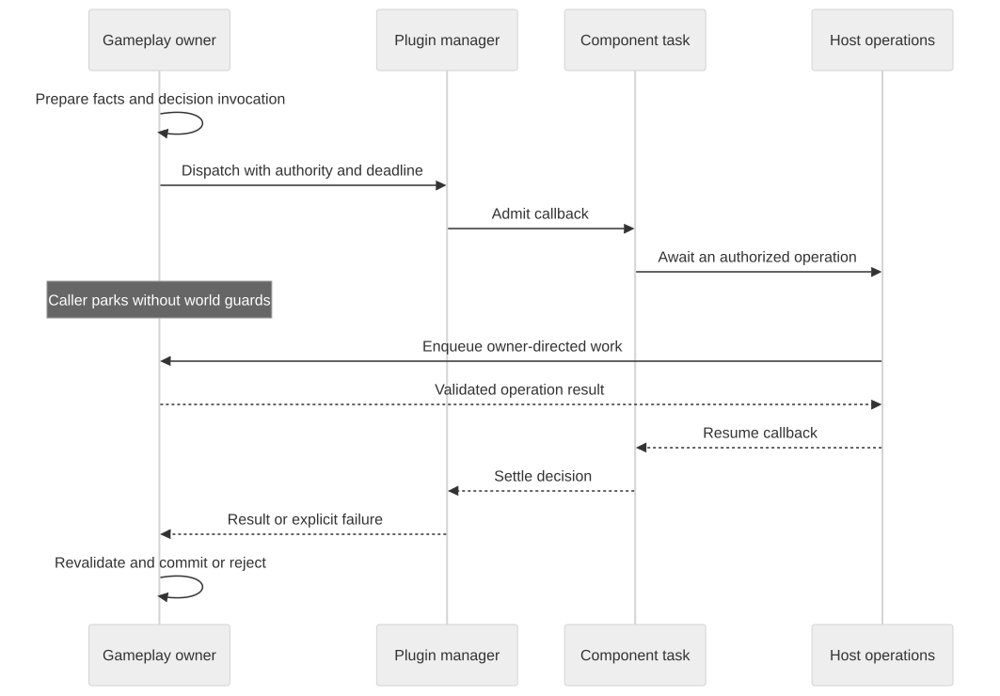

# Events and gameplay decisions

**Status:** Proposed. Current events are transferred as values; the resource-based contract is in development. See [implementation status](./implementation-status).

An event connects a server operation to interested plugins. Some events ask for a decision before gameplay continues; others report something that has happened. The delivery contract determines when a handler runs, whether its caller waits, and what the handler can change. The v0.2 model separates the facts of an operation from the changes a handler may make.

## A block-placement decision

Before placing a block, the server can prepare facts about the operation: the player, target position, and proposed block. It then invokes the relevant handlers. A protection plugin might cancel placement; another handler might propose a permitted adjustment.

The player and original target identify the operation being considered. A guest returning an event record that contains them does not make them writable: the host defines which changes are meaningful and validates them before commit.

A decision resource gives those changes a lifetime and an identity. The following WIT illustrates the separation; it is not the published Pumpkin event schema:

```wit
package example:placement@1.0.0;

interface placement {
    record facts {
        position: tuple<s32, s32, s32>,
    }

    resource decision {
        cancel: func() -> result<_, string>;
    }
}

world handler {
    import placement;
    use placement.{facts, decision};

    export handle-placement: async func(
        event: facts,
        decision: borrow<decision>,
    );
}
```

Here the handler receives facts by value and borrows the decision. `cancel` updates host-owned decision state synchronously; it does not enter a world owner or perform I/O. A method that needs to wait for authoritative state would need an appropriate async contract.

The real API also needs player and block types, typed errors, and the full set of permitted changes.

## Waiting without holding the world

A handler can await another service while the placement decision remains pending. The originating gameplay task parks without a mutable world reference. Other eligible owner work can then progress.

<div class="plugin-diagram" tabindex="0" style="--diagram-min-width: 960px">



</div>

Because the world can change during the wait, the owner checks relevant state again before commit. The player may have disconnected, the block may have changed, or ownership may have transferred. A callback result is a decision input, not permission to apply obsolete assumptions.

Snapshot data stays a snapshot: a position read from the original event may be stale after an await.

## Handler order

Blocking handlers run one at a time in ascending priority: `lowest` first, `highest` last, so the highest priority has the final say. Handlers of equal priority run in plugin dependency order, then registration order. Each handler sees the permitted changes made by earlier ones.

After a cancellation, later handlers still run, observe the cancelled state, and may reverse it. The last change in order wins. Because blocking handlers never run concurrently with each other, this order fully determines the outcome. Nonblocking handlers cannot change the decision and may run concurrently ([ADR 0003](./decisions/0003-event-decisions)). For how dispatch works today, see the [implementation status](./implementation-status).

## Decisions and notifications

| Delivery | Caller behavior | Handler result |
| --- | --- | --- |
| Decision | Waits before committing the governed action | May apply documented edits or cancellation |
| Awaited notification | Waits for delivery to settle | Does not alter the decision |
| Detached observation | Continues without waiting for execution | Cannot change the completed decision |

Only notification events may be detached. A nonblocking handler whose returned changes are ignored may still be awaited by its caller, and making it detached changes what completion means to that caller.

A detached subscription has a bounded, lossless queue. When it overflows, the host rejects further deliveries to that subscription and records a diagnostic, and repeated overflow quarantines the plugin. Coalescing is a separate opt-in for state-sampling observations such as the latest position, and never applies to a decision event.

## Expired decisions

A deadline can close a decision before the guest returns. The host then rejects later changes to that decision and applies the event's expiry outcome.

By default the outcome is to reject the governed action as if it were cancelled, and the host sends any client correction the action needs. A rejected block placement, for example, is reverted on the client. An event's reference entry may declare a different outcome.

The borrowed resource's call lifetime and the decision's validity window are different. If a guest keeps running after the deadline, the host still rejects its attempted edit, even though the call has not finished releasing its resources.

Cancelling placement does not undo unrelated effects: a message already sent or an explicit command already committed keeps its own outcome. Tests therefore check staged decision changes separately from immediate host effects.

## Representation and cost

A resource can avoid transferring fields a handler never uses, but many small getter calls can cost more than a snapshot. Decision events therefore pass facts by value and expose changes through a decision resource ([ADR 0003](./decisions/0003-event-decisions)). The no-handler path should stay cheap: dispatch should not allocate an invocation just to find that nobody subscribed.
