# Implementation status

**Status:** Source inventory. **Verified baseline:** Pumpkin [`d1816d615`](https://github.com/Pumpkin-MC/Pumpkin/tree/d1816d6157d9bbc9504a0bbb626d09e02a543562), inspected on 2026-10-28.

This page records code present at a revision. Source links are pinned so the account stays inspectable when the server changes.

## Current execution path

The Wasm loader owns the shared admission policy, and native callbacks are not governed by it. The diagram shows the standard loader arrangement; a custom loader may not share one process-wide gate.

## Integrated foundations

| Area | Evidence and limit |
| --- | --- |
| Plugin lifecycle and dependency order | The [manager](https://github.com/Pumpkin-MC/Pumpkin/blob/d1816d6157d9bbc9504a0bbb626d09e02a543562/crates/pumpkin-core/src/plugin/mod.rs) prepares plugins, sorts named dependencies, and initializes them. This does not provide a general WIT service resolver or dependent-aware retirement contract. |
| Wasm ABI selection | The [loader runtime](https://github.com/Pumpkin-MC/Pumpkin/blob/d1816d6157d9bbc9504a0bbb626d09e02a543562/crates/pumpkin-wasm-host/src/runtime.rs) selects v0.1 or v0.2 and supplies different engine modes. v0.2 is feature-gated. |
| Store drivers | The [executor](https://github.com/Pumpkin-MC/Pumpkin/blob/d1816d6157d9bbc9504a0bbb626d09e02a543562/crates/pumpkin-plugin-runtime/src/executor.rs) has bounded submission, sequential and concurrent driving, failure state, and shutdown machinery. Both modes use `LegacySyncReentry` in the current host integration. |
| Causal reentry | The [admission policy](https://github.com/Pumpkin-MC/Pumpkin/blob/d1816d6157d9bbc9504a0bbb626d09e02a543562/crates/pumpkin-plugin-runtime/src/policy.rs) and executor support inherited chains and sequential callback pumping. Context propagation across an arbitrary task hop is not automatic. |
| Async v0.2 host | The [bindings](https://github.com/Pumpkin-MC/Pumpkin/blob/d1816d6157d9bbc9504a0bbb626d09e02a543562/crates/pumpkin-wasm-host-v0_2/src/bindings.rs) and host implementations supply concurrent imports and async callback dispatch. They do not establish independent root admission or domain ownership. |
| Global scheduler | The [scheduler](https://github.com/Pumpkin-MC/Pumpkin/blob/d1816d6157d9bbc9504a0bbb626d09e02a543562/crates/pumpkin-scheduler/src/global.rs) implements bounded managed tasks and wakeups. It rejects non-Global domains and is not integrated into plugin-capable gameplay dispatch at this baseline. |
| Host resources | [Plugin host state](https://github.com/Pumpkin-MC/Pumpkin/blob/d1816d6157d9bbc9504a0bbb626d09e02a543562/crates/pumpkin-wasm-host-common/src/state.rs) contains a local resource table and server references. This is not a cross-store capability directory. |
| Event dispatch | The manager appends registrations, runs the blocking group, and awaits the nonblocking group. The priority order and cancellation rules in the [event chapter](./events#handler-order) are not implemented at this baseline. |
| Tick callbacks | The [scheduled callback path](https://github.com/Pumpkin-MC/Pumpkin/blob/d1816d6157d9bbc9504a0bbb626d09e02a543562/crates/pumpkin-wasm-host/src/scheduler.rs) launches due tasks. It is distinct from the authoritative-domain scheduler. |
| Limits and permissions | The loader configures selected WASI capabilities and optional memory limits. The complete invocation budget and delegated game-authority model are not implemented. |

## Work outside the baseline

The Rust v0.2 SDK exists in separate work at [commit `62eccc86a`](https://github.com/Pumpkin-MC/Pumpkin/tree/62eccc86a/crates/pumpkin-plugin-api-v0_2). Its component tests exercise async handler behavior. That commit is not part of the baseline above.

## Proposed integration

The following parts of the [technical design](./design) are not complete in the baseline:

- Independent v0.2 admission with explicit per-invocation context.
- Managed gameplay tasks and authoritative operation routing.
- World, Region, and Entity scheduler implementations and ownership transfer.
- Resource event invocation lifetimes, staged decisions, and late-commit rejection.
- General interface resolution, cross-store resource proxies, and extension discovery.
- Provider lifetime policies covering outstanding calls and capabilities.
- End-to-end deadlines, guest interruption, host-operation fencing, and overload behavior.

When the baseline revision changes, update the links and the status of each row together.
