# Loading components and linking providers

**Status:** Plugin file loading and named-dependency ordering exist. The provider resolver, resource proxies, and extension discovery are proposed. See [implementation status](./implementation-status).

A component starts as code and interface definitions. Loading makes it available to the runtime; instantiation gives it live state; activation makes its services available to other work. Keeping these steps distinct lets the host resolve dependencies before a plugin begins handling gameplay.

## Packages and providers

A package is an independently distributed artifact. Its instance owns private state. A provider is an implementation of an interface exported by that instance.

For example, an economy package might provide `example:ledger/accounts@1.0.0`. A shop component imports that contract. The host selects a compatible installed provider and establishes the binding before activating the shop.

The package's release version and the interface version answer different questions. A provider can fix its implementation without changing the interface, while a new interface version can require a consumer migration. [Versioning](./versioning) explains the compatibility rules.

## Resolving a dependency

Resolution begins with the component's actual imports and exports. The host checks their types, resource relationships, required execution features, and configured authority. It then selects providers and prepares the necessary bindings.

Only ready providers are published to dependent functionality. If the economy provider fails initialization, the shop cannot begin using it merely because its package file was discovered.

Initialization needs an order in which components can become ready: a cycle of initializers that each wait on the next has no first completion. Callback relationships at run time can form cycles too, but those rely on the progress guarantees described in [execution](./execution).

Instantiation and activation also have different failure cleanup. Resources created while preparing an instance remain the host's responsibility until ownership transfers. Resources already handed to a guest follow the interface's ownership rules.

## Private libraries and shared services

A utility library can be instantiated separately for each consumer. Each instance then has its own private state and a lifetime tied to that consumer.

A shared economy provider is different: all consumers intentionally address the same ledger. Creating one instance per region would create several ledgers unless the contract defines how accounts are partitioned and transactions coordinated.

| Arrangement | Appropriate when |
| --- | --- |
| Private instance | Consumers need independent state or a utility implementation |
| Shared provider | Consumers need one documented service and consistency model |
| Partitioned instances | The contract explicitly defines state partitioning and transfer |
| Composition group | Closely related components share a chosen linkage and retirement boundary |

Composition arranges components into an instance graph. It need not erase their component boundaries or duplicate the core for each extension. Host forwarding between separate stores is another arrangement, with different adaptation and lifecycle costs.

Shared engines can help compilation reuse and some linkage arrangements. A Rust host adapter can also invoke a provider in that provider's own store and engine. Direct reuse of Wasmtime objects has stricter compatibility requirements than forwarding through host code.

## Extension points

An extension point accepts multiple implementations of a contract the parent knows. An entry framework, for example, can define action and condition interfaces and discover the installed implementations.

The parent owns the entry graph and application rules. The runtime owns component calls, authority, and lifetime tracking. Extension-specific configuration can have a schema without turning execution into a generic dynamic method-call protocol.

This works because the parent knows the interface in advance. A precompiled parent cannot automatically acquire static knowledge of arbitrary new signatures after installation. Such a system would need explicit dynamic behavior or generated adaptation.

## Calling another provider

A consumer uses its generated bindings. The host routes the call to the selected provider and carries its invocation relationship across the boundary.

For ordinary values, the bridge translates between component representations. Resources require proxy identity, type mapping, ownership, destruction, and failure behavior. Streams and futures add transport lifetime and backpressure. Each type needs those semantics before the resolver accepts it, and [ADR 0004](./decisions/0004-component-contracts) lists the initial set.

## Retiring a provider

Retirement begins by stopping new unrelated calls and withdrawing the provider from discovery. Already accepted work and the callbacks needed to complete it remain tracked.

Suppose the shop retains an account resource when the economy provider is asked to unload. The host revokes the resource only if the interface can express a provider-unavailable result for it. Some function signatures cannot, so for those interfaces retirement waits until dependents drain. If retirement is forced, the host stops the dependent components, last dependent first, instead of promising transparent hot unload ([ADR 0004](./decisions/0004-component-contracts)).

A trap or forced interruption can also retire an entire store rather than one method call. Outstanding proxies and dependents need an accounted failure path. When providers hold resources from each other, waiting for dependents to drain would never finish, so the host retires the whole cycle together.

Native libraries have a stronger residency concern: their code must remain loaded while any callback, task, service, or destructor can execute it. Removing the plugin-manager entry alone does not establish that those references are gone.

The [Component Model linking design](https://github.com/WebAssembly/component-model/blob/main/design/mvp/Linking.md#fully-runtime-dynamic-linking) describes host-created plugin instances exposed through application-defined interfaces. The runtime still has to implement the discovery, authority, and retirement policy around them.
