# Implementation roadmap

**Status:** Draft. This is dependency order, not a release schedule.

The [status inventory](./implementation-status) describes existing code. The stages below describe work needed to reach the [technical design](./design). Confirmed correctness fixes can proceed independently of architectural redesign.

## Independent stabilization

Verify and fix ownership cleanup, handler precedence, callback coverage, generation failure, lifecycle identity, dependent activation, scheduled-task ownership/overlap, and native code residency. Each finding needs a narrowly scoped regression test that exercises the original failure.

Establish instrumentation and baseline workloads alongside this work. Deduplicating host logic can reduce repeated fixes, but must preserve distinct ABI behavior behind thin adapters rather than forcing a shared execution policy.

## Dependency graph

| Stage | Dependency | Acceptance gate |
| --- | --- | --- |
| A. Invocation identity and bounded lifecycle | Stabilization of affected boundaries | Task hops and overlapping calls retain correct attribution; accepted work and late effects remain accounted for |
| B. Async v0.2 execution and SDK coverage | A; interruption and dependency admission policy | Real stackless components progress independently and handle supported callbacks without legacy global root admission |
| C. Managed authoritative operations | A and B; enforceable initial owner boundary | A decision parks without world guards; same-owner host work progresses; stale results cannot commit |
| D. Resource/event contract | A; C for integrated commit semantics | Rights and lifetime are checked; facts and allowed edits are distinct; representation costs are measured |
| E. Typed component dependency binding | A and B | Separately compiled consumers call compatible providers; mismatches fail before activation |
| F. Resource proxies and extension points | D and E | Identity, ownership, borrowing, retirement, and delegated authority survive cross-store calls |
| G. World/Region/Entity ownership | C; world subsystem changes | Independent owners progress; transfers and stale operations behave correctly |
| H. Integrated acceptance and v0.1 retirement | Applicable gates above and migration criteria | Compatibility, faults, gameplay semantics, and representative workloads meet the published contract |

C requires an actual authority boundary; queueing direct mutations on a Global future does not provide one. E does not require region ownership, and G does not require the entry framework or generic library loader. F must publish its supported type surface instead of implying that arbitrary WIT works.
